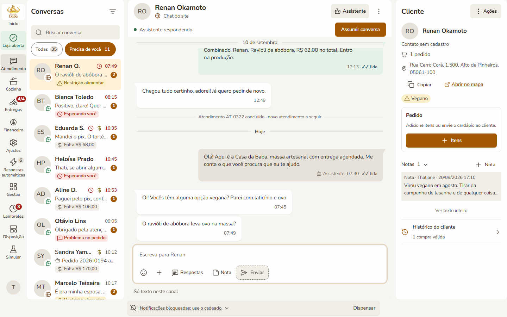
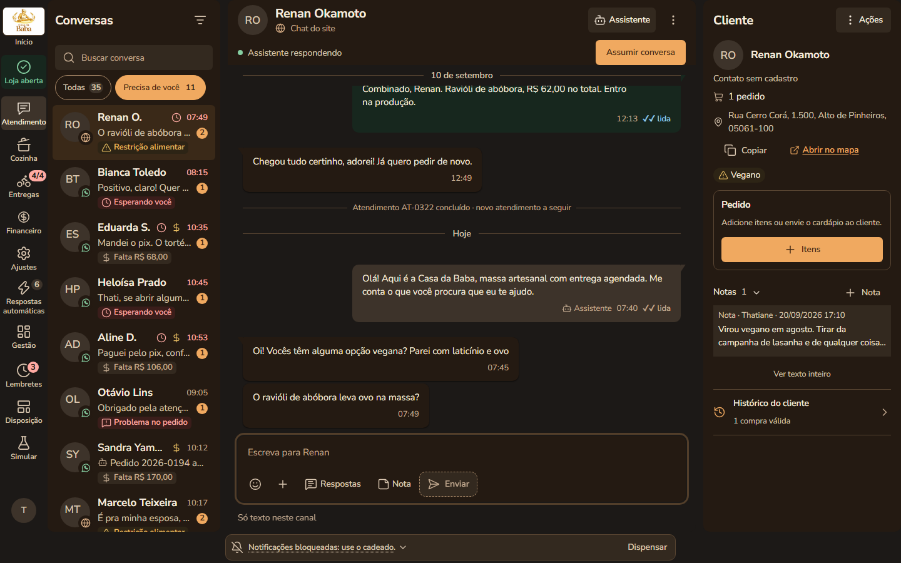
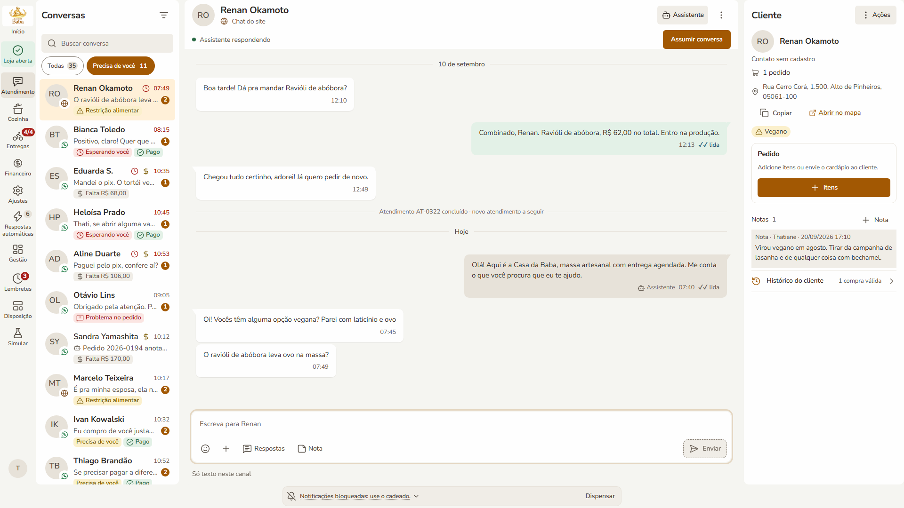
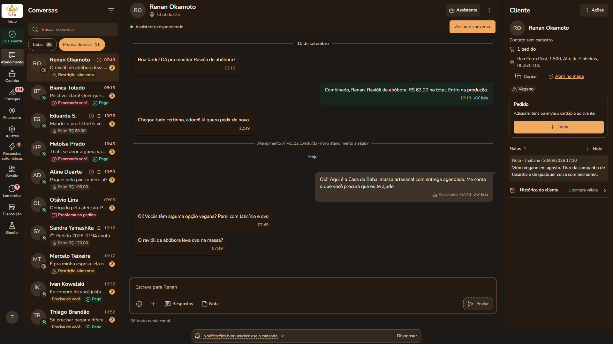

# Crítica da tela do Atendimento: coerência e poluição visual (#3234)

**Status: aprovada pelo Felipe em 23/11/2026, às 12:27.** A execução segue na seção "Execução do grupo A".

**Escopo: só desktop**, a pedido do Felipe em 23/11. O celular fica para outra rodada.

Data: 23/11/2026. Código analisado: `master` em `726ddcfc5`.

## Método

- Os prints deste documento vêm do Console em modo demonstração, rodando a partir do worktree, em 1440x900 e 1920x1080, nos temas claro e escuro. Estão na pasta [`critica-atendimento-3234/`](critica-atendimento-3234/).
- A produção foi medida só pelo layout em 23/11, numa tela de 1912x867. A medida cobre quantidade de blocos, alturas, tamanhos de fonte, cores e avisos repetidos, sem nenhum dado de cliente. O print de produção mostra contato real e ficou só com o Felipe.
- O modo demonstração não tem conversa com a janela fechada nem mensagem com falha de envio. Para esses dois casos, a evidência é a medida de produção.
- Os princípios de referência são gerais. No painel de contato dos apps de mensagem, vêm primeiro a identidade, depois as ações rápidas e, por último, a mídia trocada. Nos painéis de atendimento, o estado da conversa fica numa faixa só, com o tempo restante da janela, e as seções laterais podem ser recolhidas.

## Prints de antes (demonstração)

| 1440 claro | 1440 escuro |
|---|---|
|  |  |

| 1920 claro | 1920 escuro |
|---|---|
|  |  |

## Medidas

| Métrica | Produção 1912x867 | Demo 1440x900 | Demo 1920x1080 |
|---|---|---|---|
| Largura da conversa | 812 px | 748 px | 1176 px (61% da tela) |
| Altura útil da conversa | 560 px (65%) | 581 px (65%) | 759 px (70%) |
| Compositor (com a faixa da janela) | 203 px | 165 px | 167 px |
| Tamanhos de fonte visíveis | 6 (12, 13, 14, 15, 17, 20) | 6 | 6 |
| Cores de fundo distintas | 9 | 9 (10 no escuro) | 9 (10 no escuro) |
| Blocos na coluna do cliente | 7, somando 774 px (a coluna rola até 933 px) | 4 visíveis no print | 4 visíveis no print |
| Lugares que dizem "Janela fechada" | 3: cabeçalho, faixa e campo | n/a | n/a |
| Aviso de falha igual em sequência | 4, um por mensagem | n/a | n/a |
| Selos por cartão da lista | até 4 (ex.: Sem nome, nome da atendente, Lead, Só modelo) | 1 ou 2 | 1 ou 2 |
| Botões visíveis / menores que 24 px | 50 / 0 | 43 / 0 | 43 / 0 |

## Achados e proposta

Legenda: **Ação** pode ser manter, agrupar, recolher ou remover. **P1** pesa no uso diário, **P2** é coerência e **P3** é acabamento. A letra do **Grupo** é a PR em que o achado entra (ver adiante).

### Conversa

| ID | Problema | Evidência | Proposta | Ação | P | Grupo |
|---|---|---|---|---|---|---|
| C1 | Cada envio que falhou repete o balão e o aviso "O WhatsApp demorou a responder. Pode ter chegado…" | produção: 4 avisos iguais seguidos | Falhas seguidas do mesmo texto viram um bloco só ("4 tentativas não saíram", com "Ver detalhes"). O texto segue o status que a #3229 definir. | agrupar | P1 | A |
| C2 | "Janela fechada" aparece em 3 lugares | produção: cabeçalho, faixa e campo | Uma faixa só, compacta e com a ação. Tirar do campo e do cabeçalho. Com a janela aberta, o cabeçalho mostra o tempo restante ("Janela aberta · 3 h"). | remover duplicata | P1 | A |
| C3 | Duas entradas para a mesma lista de mensagens padrão: "Escolher modelo" na faixa e "Respostas" no compositor | `Composer.jsx:266-269`; as duas chamam `aoAbrirModelos` | Desde a #3206, "Respostas" já é a lista. Manter só uma entrada. Isso revê a decisão da #2420 e precisa do aceite do Felipe. | remover | P1 | A |
| C4 | O compositor com a faixa da janela toma 23% da altura na produção (203 de 867 px) | medidas acima | Faixa da janela numa linha só. "Só texto neste canal" vira dica dentro do campo. A faixa de notificações bloqueadas pode ser dispensada de vez. | recolher | P2 | A |
| C6 | Em tela larga a conversa estica: em 1920 px ela fica com 1176 px, a borda esquerda do balão do cliente fica a cerca de 1.130 px da borda direita do balão da loja, e a lista, com cerca de 300 px, corta a prévia | print 1920 e medidas | Largura de leitura da conversa limitada (por volta de 880 px). A sobra vai para a lista e para o cartão do cliente. | manter com ajuste | P2 | A |
| C5 | O estado "Assistente respondendo" ou "Você respondendo" ocupa uma linha própria de 40 px abaixo do cabeçalho | prints 1440 e 1920 | Estado como selo no cabeçalho, mantendo o botão "Assumir conversa" | agrupar | P2 | A |

### Lista de conversas

| ID | Problema | Evidência | Proposta | Ação | P | Grupo |
|---|---|---|---|---|---|---|
| L1 | Até 4 selos por cartão. "Só modelo" repete o estado da janela, e "Lead" e "Contato" aparecem sempre | produção | No máximo 1 selo de estado, o que pede ação, mais a contagem. "Só modelo" vira ícone de cadeado. O tipo de contato fica no cartão do cliente. | recolher | P1 | C |
| L2 | A faixa vermelha "N mensagens não entregues" fica fixa no topo da lista | produção: 40 px na cor de erro | Manter, em tom neutro com contagem. Aparece só quando há falha nova desde a última revisão. | manter com ajuste | P2 | C |
| L3 | Busca e filtros "Todas" e "Precisa de você" | prints | Sem mudança | manter | n/a | n/a |

### Cartão do cliente

| ID | Problema | Evidência | Proposta | Ação | P | Grupo |
|---|---|---|---|---|---|---|
| R1 | A identidade é boa (foto, nome, situação, telefone, endereço), mas as ações ficam espalhadas em links soltos | prints | Manter a identidade no topo. Copiar telefone, Abrir no mapa e Conferir identidade viram uma fileira de ícones com rótulo. Logo abaixo fica o espaço para a distância (#3232) e para a mídia (#3233). | agrupar | P2 | B |
| R2 | O botão "Itens", cheio na cor primária, é a área mais pesada da tela, mesmo sem pedido em andamento | prints 1440 | Botão secundário quando não há pedido aberto. O primário fica só para o pedido em montagem. | manter com ajuste | P1 | B |
| R3 | As notas aparecem abertas com o texto (134 px na produção) | produção | Mostrar a contagem e a primeira linha da nota destacada, com "Ver todas" | recolher | P1 | B |
| R4 | Entrega, Histórico do cliente e Link do cliente estão em 3 linhas separadas | produção: 45, 45 e 41 px | Uma lista única de acessos | agrupar | P2 | B |
| R5 | O Assistente tem botão no cabeçalho e também um bloco no rodapé do cartão (Organizar, Orientar) | produção: bloco de 112 px | Uma entrada só, no cabeçalho, que abre o painel móvel da #3210. No cartão fica, quando houver, um resumo de 3 linhas: o que o cliente quer, o que já se sabe e o próximo passo. | remover duplicata | P2 | B |

### Global

| ID | Problema | Evidência | Proposta | Ação | P | Grupo |
|---|---|---|---|---|---|---|
| G1 | 6 tamanhos de fonte numa tela só; 13, 14 e 15 px quase não se distinguem | medidas | 4 tamanhos: 12, 14, 16 e 20 | recolher | P2 | D |
| G2 | 9 cores de fundo ao mesmo tempo: amarelo, vermelho, laranja, verde e bege | medidas | Cor só para estado que pede ação. O resto fica neutro, com contorno uniforme de 1 px. | recolher | P2 | D |
| G3 | "Enviar" e "Gravar" têm borda tracejada e parecem desabilitados | prints | Borda sólida de 1 px, ou preenchido quando estiver pronto para enviar | manter com ajuste | P3 | D |
| G4 | O aviso "Há uma nova versão" cobre a coluna do cliente | anexo do Felipe, 22/11 | Mostrar numa faixa no topo, sem cobrir conteúdo | manter com ajuste | P3 | D |

## Grupos de PR e ordem

| Grupo | Achados | Por que nessa ordem |
|---|---|---|
| A Conversa | C1, C2, C3, C4, C5, C6 | É onde a atendente passa o tempo; ganha altura útil e fica sem aviso repetido |
| B Cartão do cliente | R1, R2, R3, R4, R5 | Abre espaço para a #3232 e a #3233 |
| C Lista | L1, L2 | Menos selos por cartão, com leitura mais rápida da fila |
| D Tipografia, cor e avisos | G1, G2, G3, G4 | Mexe no Console inteiro: PR própria com prova de contraste, por último |

Cada PR traz print antes e depois (1440 e 1920, nos dois temas), prova visual e print em produção enviado só ao Felipe.

**Relação com a #3229:** o C1 muda só o desenho, agrupando as falhas. O texto ("pode ter chegado" ou "não saiu") vem do status que a #3229 corrigir no servidor. Não há sobreposição.

## Fora

Versão celular (foco no desktop, pedido do Felipe), navegação lateral, telas fora do Atendimento e a mudança de dados de distância e mídia (#3232 e #3233).

## Para aprovar

- [x] Lista e prioridades aprovadas, ou ajustadas, pelo Felipe
- [x] C3: manter só "Respostas" como entrada da lista (revê a #2420)
- [x] Ordem dos grupos A, B, C e D

Aprovado pelo Felipe em 23/11/2026 às 12:27: "Aprovo, começa o A".

## Execução do grupo A

A revisão do plano dividiu o grupo A em três PRs, para cada uma caber numa revisão:

| PR | Itens | Situação |
|---|---|---|
| A1 | C2, C3 e C4 (faixa da janela e compositor) | mergeada (#3236) e no ar |
| A2 | C1 (falhas seguidas agrupadas) | esta |
| A3 | C5 (modo como selo no cabeçalho) | adiada para o grupo B (medida abaixo) |

Ficam fora do grupo A, com motivo:

- **C6 (largura de leitura) vai para o grupo B.** Limitar a conversa sem redistribuir a sobra para a lista e para o cartão só abre margem vazia.
- **Do C4, "Só texto neste canal" e a faixa de notificações bloqueadas vão para o grupo D (avisos).** O WhatsApp da demonstração aceita todos os formatos, então a frase não aparece nela e não dá para provar a mudança na tela. Além disso, mudar a frase de lugar mexe nos três desenhos do compositor e na decisão da #2706.

Decisões da A1:

- Com a janela aberta, o cabeçalho mostra o prazo ("Janela aberta por 3 h 10 min") sempre que a tela tem 1280 px ou mais. A prova mede, em 1280 e 1440 px, que a linha cabe mesmo com nome longo e comanda. Isso revê a regra L4 da #1761 só no desktop largo. Abaixo de 1280 px a regra antiga continua: o prazo só aparece quando falta menos de 2 h, porque ali a linha quebra.
- Com a janela fechada, "Janela fechada" aparece uma vez só. Quando o assunto da faixa junto do campo é a janela, quem avisa é a faixa. Quando a conversa está concluída ou bloqueada, a faixa fala de outra coisa e quem avisa é o cabeçalho.
- Os prints de antes e depois, tirados da demonstração, estão em `critica-atendimento-3234/a1/`.
- O botão "Escolher modelo" sai. A lista de mensagens padrão passa a ter uma entrada só, Respostas, e o campo diz onde ela está. Ficam como estão o "Modelos aprovados" perto do fim da janela (#1839) e o da bolha que falhou fora da janela.

Decisões da A2:

- Envios seguidos que falharam com o mesmo texto e o mesmo motivo viram um balão só: o mais recente, com o aviso uma vez. O grupo não atravessa mensagem do cliente, envio que saiu, troca de dia, nota, divisória nem troca de assunto.
- Só texto agrupa. Foto, modelo e anexo chegam com um rótulo no lugar do texto ("Foto"), e duas fotos diferentes virariam tentativas da mesma coisa. Recusas com motivos diferentes também ficam separadas.
- A mensagem que a atendente reenvia fora de um grupo fica solta: se a nova falha a deixar igual à vizinha, ela continua à vista com o retorno do reenvio, em vez de sumir num grupo fechado. A mais recente de um grupo, reenviada, continua a cabeça dele; só uma falha nova igual, mandada depois, a leva para as tentativas de antes.
- O grupo é guardado pela tentativa mais antiga: aberto continua aberto quando uma nova falha igual entra. Grupos abertos e mensagens soltas são de cada conversa: ir a outra e voltar não perde nem mistura.
- O texto do aviso sai do tipo da falha. Com tempo esgotado, a mensagem pode ter chegado, então o aviso diz "4 tentativas sem resposta do WhatsApp. Pode ter chegado: confira com o cliente antes de reenviar." e nunca "não saíram". Nos outros tipos, "N tentativas não saíram", seguido do motivo. O status em si continua com a #3229.
- "Ver as N tentativas" mostra as de antes acima da mais recente. Cada uma diz só "Tentativa 1 de 4", sem repetir o aviso na tela nem para o leitor de tela (um só `role=alert`), sem Reenviar, sem o retorno de um reenvio antigo e sem "Modelos aprovados", que ficam só na mais recente. As de antes mantêm reagir e apagar.
- Os prints de antes e depois, tirados do harness da prova-2185 (a demonstração não tem envio com falha), estão em `critica-atendimento-3234/a2/`.

Por que a A3 (C5) foi para o grupo B:

- O selo no cabeçalho não cabe ao lado do Assistente e do menu sem quebrar a linha "WhatsApp · Janela aberta por…", que a A1 deixou numa linha só. Com o painel do cliente aberto, o cabeçalho da conversa tem 580 px em 1280 e 740 px em 1440 (812 px na produção, em 1912).
- Selo e "Assumir conversa" juntos quebram a linha nessas larguras. Só o selo, sem o Assumir, ainda quebra em 1280 com o cliente aberto e em 1440 com nome longo e comanda: o cabeçalho passa de 64 para 77 px.
- O ganho só aparece com a coluna larga (1920, ou o cliente fechado), e não no uso comum. A saída depende de como o grupo B redistribui a largura entre a lista, a conversa e o cartão do cliente. Duas opções para levar ao B: o cabeçalho em duas linhas ou o botão do Assistente só com o ícone.
