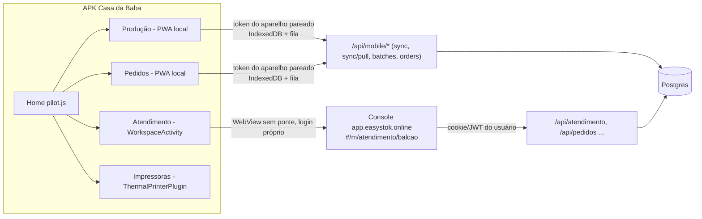

# Diagnóstico: app Casa da Baba (Atendimento, Pedidos, Produção)

Data: 03/11/2026. Base: `master` em `8ce7716a6`. Somente leitura. Impressão fica em `impressao.md` (sessão própria).

> Retrato de 03/11/2026, não é o estado atual. O que virou trabalho: push visível (#2195), código de acesso para entrar no Atendimento (#2201) e impressão v2 (#2197). Para o estado de hoje, confira o código e as issues.

## 1. O que é o app hoje

O APK (`casa-da-baba-mobile/apk`, v0.8.6, versionCode 13) é Capacitor 6 sobre o **PWA** `EasyStock.Api/wwwroot/pwa`,
copiado no build por `scripts/copy-web.cjs`. A Home tem duas metades com donos, auth e dados diferentes:

| Área | Onde roda no APK | Auth | Offline | Fonte da verdade |
|---|---|---|---|---|
| Produção | PWA local (`index.html`, `sync.js`) | token de aparelho (`/api/mobile/devices/pair`) | sim, fila local | lote local, depois `/api/mobile/sync` |
| Pedidos | PWA local (`local-orders`) | token de aparelho | sim | pedido local, vínculo ao ERP por `/api/mobile/orders/{id}/link` |
| Atendimento | WebView nativo do Console de produção | login do Console, separado | não | servidor |

## 2. Cruzamento de rotas

| Cliente | Rotas literais | Sem endpoint no back |
|---|---|---|
| PWA/APK (`sync.js`, `index.html`, `upload-photos.js`, `pilot.js`) | 26 | `POST /api/mobile/tickets` |
| Console (`EasyStock.Console/src`) | 131 | `/api/agente` (só existe no proxy de dev, `vite.config.js:17`); 4 do financeiro são falso positivo de template |
| Back (`EasyStock.Api`) | 684 endpoints extraídos | 60 em `/api/mobile/*` |

Limite: o Console monta parte das rotas por prefixo em módulos de `infra/api/`; o cruzamento pega só o literal.

## 3. Bugs e inconsistências

| # | Sev | Achado | Evidência | Tipo |
|---|---|---|---|---|
| 1 | P1 | Chamado automático de erro do app vai para rota inexistente: `POST /api/mobile/tickets` devolve 404 e o código engole (`if (!resp.ok) return null`). Nenhum erro do aparelho vira chamado. | `EasyStock.Api/wwwroot/pwa/sync.js:2770`; sem rota em `EasyStock.Api` nem no histórico (`git log -S"/tickets"`) | Fato |
| 2 | P1 | Atendimento no APK aponta fixo para produção (`https://app.easystok.online/...`), enquanto Produção e Pedidos usam `CDB_API_BASE_URL`. APK de QA ou laboratório abre o Atendimento real. | `WorkspaceActivity.java:24` e `:84-85` x `scripts/copy-web.cjs:13` | Fato |
| 3 | P1 | Duas identidades no mesmo aparelho: Produção/Pedidos usam o token do pareamento; Atendimento exige login do Console no WebView, sem ponte nem troca de token. A operadora loga duas vezes e o "Registrando como" da Home não vale no Atendimento. | `WorkspaceActivity.java:76` ("não recebe a bridge"); `pilot.js:350-372` | Fato (efeito na operação: inferência) |
| 4 | P1 | Impressão pelo Atendimento do APK não funciona: o WebView não tem `PrintManager` nem ponte, e o Android ignora `window.print()`. | `WorkspaceActivity.java:67-99` (achado da sessão de impressão) | Fato |
| 5 | P1 | Dois modelos de pedido: o pedido local do aparelho e o pedido do Console só se encontram pelo vínculo manual `orders/{id}/link`. Consolidação de venda soma só item vinculado ao ERP (#950) e pedido criado antes do vínculo prato→produto não baixa saldo (#1619). | `MobileOrdersController.cs:54`; issues #950, #1619 abertas | Fato (issues) |
| 6 | P1 | Dois registros de produção (PWA e Console) com reconciliação posterior: produção do aparelho some, validade +1 dia e saldo divergente (#2083, aberta). O +1 dia combina com o débito de fuso UTC x BRT (#553, aberta). | issues #2083, #553; `SyncController.cs:50` | Fato (issues); causa: inferência |
| 7 | P1 | Tabelas `mobile_*` sem RLS `tenant_isolation` (#2180, aberta); auditoria de RLS em produção é P0 aberta (#275). | issues #2180, #275 | Fato (issues) |
| 8 | P2 | Atendimento do APK sem offline: `onReceivedError` só esconde o WebView. Produção e Pedidos seguem offline, então a Home mistura dois comportamentos sem avisar. | `WorkspaceActivity.java:93-98` | Fato |
| 9 | P2 | IA do Console: modos `cli`/`api` chamam `/api/agente`, que só existe no servidor local de desenvolvimento. Se o modo for escolhido em produção, a pergunta livre falha (há timeout de 20 s). | `infra/conexaoAgente.js:11,52`; `vite.config.js:5-17` | Inferência: falta confirmar se o modo é selecionável em produção |
| 10 | P2 | O PWA é a base do APK e ao mesmo tempo está "congelado como backup" pela direção do produto. Mudança no PWA muda o APK sem passar pelo Console. | `copy-web.cjs:5`; memória "ERP Casa da Baba" | Fato |

### Impressão (detalhe em `impressao.md`)

17 achados: 3 P1, 5 P2, 9 P3. Os P1:

| # | Achado | Evidência |
|---|---|---|
| B1 | Recibo de pedido do APK sai em ESC/POS texto, sem acento, contra a regra "térmica em raster" | `pwa/index.html:19295`, `:19128` |
| B2 | Atendimento do APK não imprime (WebView sem `PrintManager`); é o achado 4 acima | `WorkspaceActivity.java:24,67-76` |
| B3 | Mesma etiqueta de produção em três layouts (80x40 Console, 58 mm APK, 80x40 legado) | `EtiquetaDeProducao.jsx`, `pwa/etiqueta-termica.js` |

Também: canhoto com `Falhou` some do radar e não tem retry (B4, B5); `GET api/etiquetas/templates/{origem}/{id}` chamado pelo Web e inexistente na API (B9); não há entidade de impressora no back (B13).

## 4. Carga aberta por área (issues abertas: 256)

| Área | Issues | P0 | P1 | P2 | P3 |
|---|---|---|---|---|---|
| Atendimento | 57 | 1 | 20 | 24 | 8 |
| Pedidos | 59 | 2 | 20 | 26 | 7 |
| Produção | 28 | 1 | 12 | 11 | 4 |
| APK/PWA | 22 | 0 | 5 | 6 | 7 |

Classificação por palavra no título; uma issue pode contar em duas áreas.

Temas que se repetem: **estado do pedido x Pix/estorno** (#264, #265, #1724, #868); **restos de banca de 13/10** ainda abertos (#1717, #1765, #1776); **sincronização APK x Console** (#2083, #1630); **fuso horário** (#553); **isolamento por empresa** (#275, #2180).

## 5. Lacunas

- Os leitores automáticos de APK, Console e back não devolveram relatório. Este documento vem de buscas diretas. Faltam: máquina de estados completa de Pedido e Conversa, jobs e retries do Worker, e cobertura de testes por área.
- Nada foi executado na tela real nem no laboratório. Os achados 3 e 8 precisam de prova no aparelho.
- O cruzamento de rotas do Console não pega rotas montadas por prefixo.

## 6. Ordem sugerida

1. #1 tickets (rota nova ou remover a chamada): barato e devolve visibilidade dos erros do aparelho.
2. #2 host fixo do Atendimento: ler do mesmo `CDB_CONFIG`.
3. #3, #4 e #8 juntos: decidir se o Atendimento do APK ganha ponte nativa (token, impressão, estado offline) ou fica como atalho declarado.
4. #5 e #6: fonte única de pedido e de produção entre aparelho e Console (é o centro da unificação).
5. #7: RLS antes de ampliar o uso do APK.
