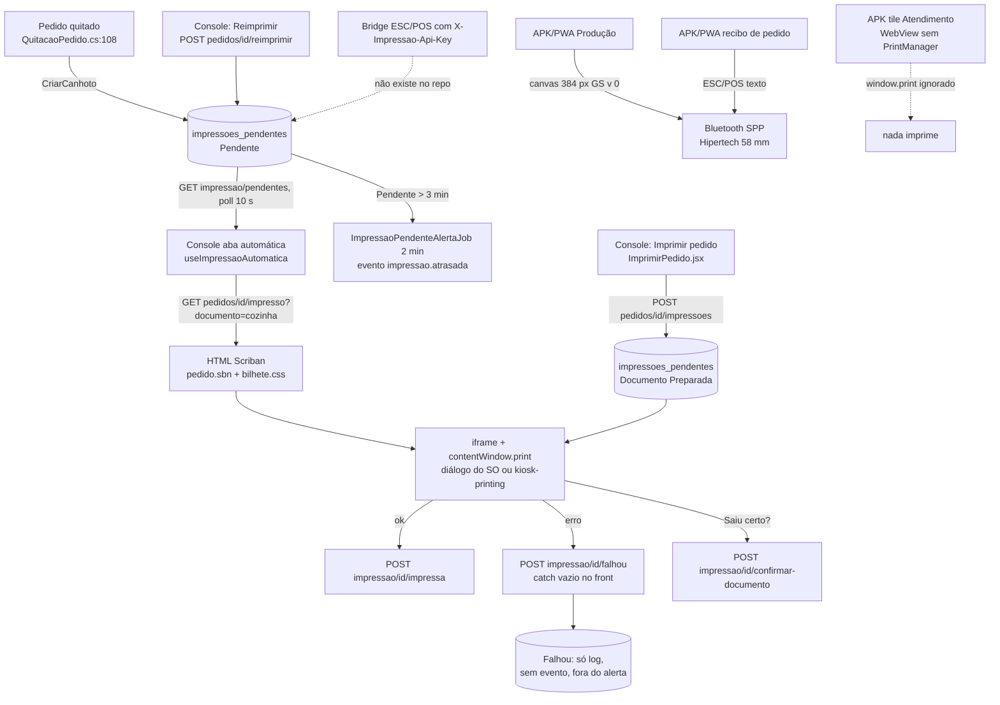

# Diagnóstico de impressão (2026-11-03)

Inventário somente leitura, base `master` em `8ce7716a6`. Nada foi executado: sem build, teste, servidor ou aparelho.
Convenção: **FATO** = lido no código nesta base; **INFERÊNCIA** = deduzido, falta prova em execução.
Caminhos relativos à raiz do repositório.

> Retrato de 03/11/2026, não é o estado atual. Virou a impressão v2 (#2197, spec em `docs/plan/impressao-v2/README.md`): F0 (#2206), F1 e F2 (#2207), F3 (#2203) e F4 servidor (#2205). Para o estado de hoje, confira o código e a spec.

## 1. Resumo

| App | Mecanismo | Impressora alvo | Escolha da impressora | Registra na fila do back |
|---|---|---|---|---|
| Console (web) | HTML da API em iframe oculto + `contentWindow.print()`; PDF local como plano B | Qualquer uma do sistema operacional (HP A4/A5, térmica 58/80, etiqueta 10x15) | Diálogo do SO; o "perfil" é só rótulo + papel em `localStorage` | Sim (`/impressa`, `/falhou`, `/confirmar-documento`) |
| APK Casa da Baba, telas nativas e PWA embarcada | ESC/POS por Bluetooth Classic SPP (plugin Java próprio) | Hipertech WTP05 58 mm (384 px, 32 colunas) | Lista de pareadas, salva em `localStorage` `cdb-printer` | Não |
| APK, tile Atendimento | Console carregado num `WebView` puro (`WorkspaceActivity`) | Nenhuma (ver B2) | n/a | n/a |
| PWA standalone | Igual ao APK (shim `window.bluetoothSerial`) e `window.print` em lista de compras | 58 mm | `printerPickerModal` | Não |
| Web Razor (congelado) | Só `window.print()` | A4 e 80 mm | Diálogo do SO | Não |

Admin: o projeto `EasyStock.Admin` não existe na solução (FATO, `EasyStok.sln`).
Nenhum app fala IPP, TCP 9100, WebUSB, Web Serial, BLE ou Android Print Framework (FATO, grep vazio). A HP Smart Tank só é alcançada pelo diálogo do SO do Console, o que é compatível com IPP genérico e não exige driver no código.

## 2. Back-end

### 2.1 Entidades e tabelas

| Entidade | Arquivo | Tabela | Migração | RLS |
|---|---|---|---|---|
| `ImpressaoPendente` (canhoto e documento) | `EasyStock.Domain/Entities/Operacao/ImpressaoPendente.cs:15` | `impressoes_pendentes` | `20260930153537_AddImpressaoPendente` (cria), `20261012160749_AddHistoricoDocumentoImpresso` (13 colunas: `Documento`, `Modelo`, `Perfil`, `Versao`, `Html`, `Hash`, `SolicitacaoId`, `OriginalId`, `Intencao`...) | Sim (`AddImpressaoPendente.cs:73`) |
| `StatusImpressao` | `EasyStock.Domain/Enums/Operacao/StatusImpressao.cs:4` | Pendente=1, Impressa=2, Falhou=3, Preparada=4 | n/a | n/a |
| `TipoImpressao` | `EasyStock.Domain/Enums/Operacao/TipoImpressao.cs:4` | Canhoto=1, Documento=2 | n/a | n/a |
| `EtiquetaTemplate` | `EasyStock.Domain/Entities/EtiquetaTemplate.cs` | `etiqueta_templates`, `etiqueta_templates_sistema`, `etiqueta_empresa_default` | `20260514111103_EtiquetaTemplates`, `20260514120001_EtiquetaTemplatesRedesign` | **Não** (dívida listada em `CoberturaRlsTests.cs:27`) |

Não existe entidade de impressora nem de perfil de impressora no back (FATO). O perfil chega como texto livre na coluna `Perfil`.

### 2.2 Endpoints

Políticas: `Operador` = JWT com nível SuperAdmin/Admin/Gerente/Operador. `ImpressaoFila` = `Operador` **ou** header `X-Impressao-Api-Key` (config `Impressao:ApiKey` + `Impressao:EmpresaId`, via env `Impressao__ApiKey`; `EasyStock.Api/Authorization/ImpressaoApiKeyAuthHandler.cs:13,41,92-100`).

| Método | Rota | Auth | Executor | Consumidor no repo |
|---|---|---|---|---|
| POST | `api/pedidos/{id}/impressoes` | Operador | `DocumentosImpressosController.cs:23` Preparar | Console `infra/api/impressosApi.js` |
| POST | `api/pedidos/{id}/impressoes/previa` | Operador | `DocumentosImpressosController.cs:49` | Console |
| POST | `api/impressao/resumo-atendimento?modelo=` | Operador | `DocumentosImpressosController.cs:64` (`ResumoAtendimentoHtml`) | Console (`ModalEncerrar.jsx`) |
| GET | `api/pedidos/{id}/impressoes?pagina=` | Operador | `DocumentosImpressosController.cs:78` histórico | Console |
| GET | `api/pedidos/{pedidoId}/impressoes/{id}/html` | Operador | `DocumentosImpressosController.cs:85` reimprimir original | Console |
| GET | `api/pedidos/{id}/impresso?documento=&modelo=&logoTermica=` | ImpressaoFila | `PedidoImpressoController.cs:23` (`PedidoImpressoHtml`) | Console `dominio/impressos.js`, `kdsApi.js:36` |
| GET | `api/pedidos/{id}/comanda?modelo=` | ImpressaoFila | `PedidoImpressoController.cs:51` (`ComandaHtml`) | Console `dominio/impressos.js` |
| GET | `api/pedidos/{id}/canhoto?formato=html\|texto` | ImpressaoFila | `ImpressaoController.cs:41` (`CanhotoHtml`, `CanhotoTexto`) | **Nenhum** (ver B6) |
| GET | `api/impressao/pendentes?limite=&desde=` | ImpressaoFila | `ImpressaoController.cs:59` | Console `kdsApi.js` |
| POST | `api/impressao/{id}/impressa` | ImpressaoFila | `ImpressaoController.cs:72` | Console `kdsApi.js:28` |
| POST | `api/impressao/{id}/falhou` | ImpressaoFila | `ImpressaoController.cs:78` | Console `kdsApi.js:31` |
| POST | `api/impressao/{id}/confirmar-documento` | Operador | `ImpressaoController.cs:103` (mesmo use case de `/impressa`, com `CanhotoId`) | Console `impressosApi.js` |
| POST | `api/pedidos/{id}/reimprimir` | Operador | `ImpressaoController.cs:84` `ReimprimirCanhotoUseCase` | Console `kdsApi.js` |
| GET | `api/kds/pedidos` | Operador | `KdsController.cs:28` | Console |
| PATCH | `api/kds/pedidos/{id}/status` | Operador | `KdsController.cs:42` | Console |
| POST | `api/kds/pedidos/status-lote` | Operador | `KdsController.cs:65` | não localizado (não conferido a fundo) |
| GET | `api/lotes/{id}/etiquetas/render` | Operador | `LotesController.cs:120` | Console `producaoApi.js:66`; PWA `etiqueta/`; Web |
| POST | `api/lotes/{id}/etiquetas/marcar-impressas` | Operador | `LotesController.cs:135` | PWA `etiqueta/`; Web. Console não chama |
| GET | `api/etiquetas/templates` | Operador | `EtiquetaTemplatesController.cs:21` | PWA `etiqueta/`; Web |
| POST | `api/etiquetas/templates` | Operador | `:31` | PWA `etiqueta/`; Web |
| PUT | `api/etiquetas/templates/{id}` | Operador | `:54` | Web `editor.js:851` |
| DELETE | `api/etiquetas/templates/{id}` | Operador | `:82` | PWA `etiqueta/`; Web |
| POST | `api/etiquetas/templates/{origem}/{id}/set-default` | Operador | `:97` | PWA `etiqueta/`; Web |
| GET | `api/etiquetas/templates/{origem}/{id}` | **rota inexistente** | n/a | Web `EtiquetasService.cs:13`, `editor.js:125` (ver B9) |
| GET | `api/estoque/{id}/etiqueta/pdf` | JWT | `ItemEstoqueController.cs:158` | Web `EntradasService.cs:59` só |

### 2.3 Fila e jobs

- Quem enfileira canhoto: quitação do pedido (`EasyStock.Application/Services/Pedidos/QuitacaoPedido.cs:108`) e reimpressão (`ReimprimirCanhotoUseCase.cs:30`). Documento (`Preparada`) nasce em `POST .../impressoes`.
- `ImpressaoPendenteAlertaJob` (`EasyStock.Api/BackgroundServices/ImpressaoPendenteAlertaJob.cs:18`): a cada 2 min busca canhoto `Pendente` com mais de 3 min e menos de 12 h (`AlertarImpressoesAtrasadasUseCase.cs:23-24`), emite `impressao.atrasada` e `NotificarImpressaoTravadaUseCase`.
- `Falhou` não volta para a fila, não gera evento e não entra no alerta: só log (`RegistrarRetornoImpressaoUseCase.cs:51`). Ver B5.
- Sem retry automático no back. Retry = reimpressão manual, que cria nova linha.
- O `EasyStock.Worker` não participa de impressão (FATO, grep vazio).

### 2.4 Configuração

| Chave | Onde | Efeito |
|---|---|---|
| `Impressao:ApiKey` / env `Impressao__ApiKey` | `ImpressaoApiKeyAuthHandler.cs:13-20` | Habilita o bridge. Sem chave, só JWT |
| `Impressao:EmpresaId` | idem `:49` | Tenant do bridge (obrigatório com a chave) |
| Variáveis `EZ_*` de impressão | n/a | Nenhuma encontrada |

## 3. Templates

| Nome | Onde mora | Formato | Quem usa | Alvo |
|---|---|---|---|---|
| Pedido (bilhete) | `EasyStock.Api/Data/Templates/Impressao/pedido.sbn` + `bilhete.css` via `ImpressoHtml`/`PedidoImpressoHtml` | Scriban → HTML, `@page size:auto` em bobina | Console | cupom-80 (padrão), a5, cupom-58 |
| Comanda | `.../comanda.sbn` via `ComandaHtml` | HTML | Console | cupom-80, a5 |
| Agendamento | `.../agendamento.sbn` | HTML | Console | a5 (padrão), cupom-58 |
| Entrega | `.../entrega.sbn` | HTML | Console | etiqueta-10x15 (padrão), a4 |
| Resumo do atendimento | `.../resumo.sbn` via `ResumoAtendimentoHtml` | HTML | Console encerramento | a4 |
| Canhoto de cozinha (novo) | `pedido.sbn` com `documento=cozinha` | HTML | Console KDS e automática (`kdsApi.js:34-36`) | cupom-80 |
| Canhoto S20 (antigo) | `CanhotoHtml.cs` + `canhoto.css` | HTML 80 mm, `@page 80mm auto` | ninguém | 80 mm |
| Canhoto S20 texto | `CanhotoTexto.cs:15` | Texto 42 colunas sem acento | ninguém | ESC/POS 80 mm |
| Canhoto PDF local | `EasyStock.Console/src/dominio/impressao.js` (`documentoDoCanhoto`) | PDF 80 mm | Console plano B / demo | 80 mm |
| Etiqueta de produção (Console) | `EasyStock.Console/src/features/gestao/producao/etiqueta/EtiquetaDeProducao.jsx` | HTML + SVG 80x40 mm | Console Produção | etiqueta 80x40 |
| Etiqueta de produção (APK) | `EasyStock.Api/wwwroot/pwa/etiqueta-termica.js` | Bitmap 384 px 1 bit, `GS v 0` | APK/PWA | térmica 58 mm |
| Recibo de pedido (APK) | `EasyStock.Api/wwwroot/pwa/index.html:19295` `escPosOrderLabel` | ESC/POS texto, sem acento (`asciiNorm` :19128) | APK/PWA | térmica 58 mm |
| Etiqueta texto fallback (APK) | `index.html:19700` `escPosLabelProducao` | ESC/POS texto | APK quando o raster falha | 58 mm |
| Etiquetas de lote (legado) | `EasyStock.Api/wwwroot/pwa/etiqueta/*` = cópia byte a byte de `EasyStock.Web/wwwroot/etiqueta/*` (12 arquivos) | HTML + `window.print`, templates `sys-*` (`imprimir.js:17-19`) | Web; PWA (inalcançável, B8) | 80x40 mm |
| Recibo e etiqueta de entrega (Web) | `EasyStock.Web/Views/Pedidos`, `etiqueta-pedido.css` | HTML | Web congelado | A4, 80 mm |

## 4. Impressoras e perfis

| Onde | Perfis | Persistência | Como escolhe |
|---|---|---|---|
| Console | `sistema`, `hp-a4`, `hp-a5`, `termica-80`, `termica-58`, `etiqueta-10x15` (`dominio/impressos.js`), papel por documento | `localStorage` `easystok.impressao.v1` (v2) e `easystok.impressao.automatica.v1` (`infra/api/preferenciasImpressao.js`) | Perfil define o `modelo` pedido à API; a impressora física é a do diálogo do SO ou a padrão com `--kiosk-printing` |
| APK/PWA | `escpos` (Hipertech WTP05) e `oasis-pending` (sem driver, bloqueia) | `localStorage` `cdb-printer`, `cdb-printers` (`index.html:15340-15360`) | `printerPickerModal` entre pareadas Bluetooth |
| Back | nenhum | coluna texto `impressoes_pendentes.Perfil` | não escolhe |

## 5. Fluxo ponta a ponta

Falha por app: Console automática registra `falhou` e não retenta na visita (`useImpressaoAutomatica.js:74`, `tentadas` em memória); APK/PWA sem retry por design, botão `etqRetry` (`index.html:19411`, :20590-20660), watchdog de 60 s; Web sem tratamento.

## 6. Bugs e inconsistências

| # | Sev. | Tipo | Achado | Evidência |
|---|---|---|---|---|
| B1 | P1 | FATO | Recibo de pedido do APK/PWA sai em ESC/POS **texto** sem acento, contra a regra "térmica em raster". O teste de raster cobre só a etiqueta de produção | `EasyStock.Api/wwwroot/pwa/index.html:19295`, `:19128`; `tests/pwa/etiqueta-termica.test.js` |
| B2 | P1 | FATO no código, INFERÊNCIA no efeito | Atendimento do APK abre o Console num `WebView` sem `PrintManager`, sem ponte JS e com janelas bloqueadas. O Android WebView não implementa `window.print()`, e o plano B `window.open` cai no bloqueio: impressão do Atendimento (pedido, resumo, comanda) no APK não sai | `casa-da-baba-mobile/apk/android/app/src/main/java/com/casadababa/app/WorkspaceActivity.java:24,67-76`; `EasyStock.Console/src/componentes/htmlNoNavegador.js:85` |
| B3 | P1 | FATO | Regra divergente entre Console e APK: mesma etiqueta de produção em três layouts e larguras (80x40 HTML no Console, 58 mm bitmap no APK, 80x40 legado) e mesmo pedido em dois formatos (HTML da API no Console, ESC/POS texto local no APK). O APK não usa template do back nem registra na fila | `EtiquetaDeProducao.jsx`; `pwa/etiqueta-termica.js`; `pwa/etiqueta/imprimir.js:17-19`; `index.html:19295` |
| B4 | P2 | FATO | Canhoto com `Falhou` some do radar: não volta a `pendentes`, o job de atraso só olha `Pendente` e nenhum evento é emitido. No front, o erro do próprio `/falhou` é engolido | `ImpressaoPendenteRepository.cs:60`; `RegistrarRetornoImpressaoUseCase.cs:51`; `EasyStock.Console/src/aplicacao/useImpressaoAutomatica.js:74` |
| B5 | P2 | FATO | Impressão automática do Console sem retry na mesma visita e erro de rede da fila em `catch {}` silencioso | `useImpressaoAutomatica.js:74` |
| B6 | P2 | FATO | Endpoint sem consumidor: `GET api/pedidos/{id}/canhoto` (html e texto) e o caminho `X-Impressao-Api-Key` existem para um bridge ESC/POS que não está no repo. O CSS ainda tem `@page{size:80mm auto}`, a sintaxe que cai no A4 corrigida pela #1829 só nos impressos novos. O formato `texto` (42 colunas sem acento) também contraria a regra do raster | `ImpressaoController.cs:41-56`; `EasyStock.Api/Data/Templates/Impressao/canhoto.css:5`; `CanhotoTexto.cs:15`; `kdsApi.js:34` (Console trocou de rota) |
| B7 | P2 | FATO | Template duplicado byte a byte: 12 arquivos de `EasyStock.Web/wwwroot/etiqueta` iguais a `EasyStock.Api/wwwroot/pwa/etiqueta` | relatório de comparação, pastas citadas |
| B8 | P2 | FATO | Código morto no PWA: `etqAbrirImprimir` sem chamador, então a UI legada "Imprimir etiquetas" é inalcançável. Templates `sys-*` usam cinza (`ink-500`) e rodapé "@easystok", contra a marca | `EasyStock.Api/wwwroot/pwa/etiqueta/imprimir.js:17-19,24` |
| B9 | P3 | FATO | Consumidor sem endpoint: o Web chama `GET api/etiquetas/templates/{origem}/{id}`, que a API não expõe. O editor de template do Web quebra ao abrir (efeito é inferência) | `EasyStock.Web/Services/EtiquetasService.cs:13`; `EasyStock.Web/wwwroot/etiqueta/editor/editor.js:125`; `EasyStock.Api/Controllers/EtiquetaTemplatesController.cs:21-97` |
| B10 | P3 | INFERÊNCIA | Módulo `pwa/etiqueta/` usa `credentials:'include'` sem token; no APK a auth é `X-Device-Id` + `X-Mobile-Api-Key`, então deve dar 401. Contrato mistura PascalCase e camelCase | `pwa/etiqueta/imprimir.js`; `casa-da-baba-mobile/.../sync.js:429-434`; `Console/src/infra/api/producaoApi.js:68` |
| B11 | P3 | FATO | Dois endpoints para confirmar a mesma linha (`/impressa` e `/confirmar-documento`) com o mesmo use case e auth diferente | `ImpressaoController.cs:72,103` |
| B12 | P3 | FATO | `etiqueta_templates` e `etiqueta_empresa_default` sem RLS (dívida anterior a #1238) | `EasyStock.Infra.Postgre.IntegrationTests/Tenancy/CoberturaRlsTests.cs:27` |
| B13 | P3 | FATO | Perfil gravado como texto livre; não há entidade de impressora/perfil no back, então nada audita qual impressora imprimiu | `EasyStock.Console/src/componentes/ImprimirPedido.jsx:113`; `ImpressaoPendente.cs:41` |
| B14 | P3 | FATO | `oasis-pending` aparece no seletor do APK e bloqueia a impressão | `index.html:19374,20832` |
| B15 | P3 | FATO | `setTimeout(window.print, 50)` sem esperar fontes, diferente de `htmlNoNavegador` que espera 4 s | `Console/src/features/gestao/producao/AbaProducaoDoDiaApi.jsx:160`, `AbaEstoqueDoDiaApi.jsx:121` |
| B16 | P3 | FATO | Legado Web: `@page{size:80mm auto}` inválido, texto cinza `#64748b` em térmica, comentário dizendo que não há endpoint de KDS (existe desde #1155) | `EasyStock.Web/wwwroot/css/etiqueta-pedido.css:62,114`; `EasyStock.Web/Controllers/KdsController.cs:12` |
| B17 | P3 | FATO | Governança: a regra "HP Smart Tank via IPP genérico, nunca driver HP" não está em ADR, AGENTS.md nem plano. A regra da térmica vive só em `docs/plan/atendimento-whatsapp/12-impressos.md:16`. Nenhuma ADR trata de impressão | `docs/adr/` (0011, 0012, 0021 são de rotulagem nutricional) |

### Testes ausentes

| Área | Existe | Falta |
|---|---|---|
| Back render | `EasyStock.Api.UnitTests/Services/Impressao/*` (Code128, QR, fontes, Comanda, PedidoImpresso, Resumo, 9 snapshots) | `CanhotoHtml`/`CanhotoTexto` sem snapshot próprio; nenhum teste valida `@page` do `canhoto.css` |
| Back fila | `ImpressaoControllerTests.cs`, `KdsControllerTests.cs` | Teste de que `Falhou` gera aviso (não gera) |
| Console | só provas manuais `ferramentas/prova-*.mjs`; `package.json` só tem lint | Unidade de `htmlNoNavegador`, `geometriaImpresso`, `useImpressaoAutomatica` |
| APK | `tests/pwa/etiqueta-termica.test.js` (10), `etiqueta-caminhos.test.js` | Raster do recibo de pedido; plugin `ThermalPrinter*`; impressão no `WorkspaceActivity` |

## 7. Histórico

| Ref | Estado | Assunto |
|---|---|---|
| #1632 | aberta | Bilhete da casa: F1 e F2 entregues (#1638); falta F3 (migração, tier alto) e conferência física em 80, 58, 10x15 e HP |
| #2129 | aberta | APK Casa da Baba: ondas 4a/4b/4c de etiqueta (sem corte, alérgenos, 56/80/10x15 raster, golden 203 dpi) |
| #402, #403 | abertas | RDC 727: variável obrigatória vira "—"; erro de QR/Code128 não bloqueia a impressão |
| #1883, #1641, #1686 | abertas | Nome e número da comanda |
| #809, #1174 | abertas | Remoção do Web e do MAUI |
| #1756 / PR #1829 | fechada / mergeada | Perfis e papel por documento, `@page size:auto` |
| PR #2142 | mergeada (29/10) | Térmica em imagem com a marca |
| PRs abertas de impressão | nenhuma | |
| Incidentes em `docs/dev/incidentes/` | nenhum de impressão | |

Branch `fix/impressao-perfis-1756` (worktree `C:/rep/.worktrees/EasyStok/impressao-perfis-1756`): 0 commits à frente, 12 arquivos modificados + 1 novo de 13/10, **superados** pelo master (a #1829 reimplementou em branch nova; snapshots idênticos; `geometriaImpresso.js` do master é mais completo). Aplicar regrediria o Console. Não foi tocada. Descartar depende do Felipe e de confirmar que nenhuma sessão a usa.

## 8. Lacunas

- Nada executado: B2 (WebView) e B10 (401 do módulo legado) precisam de prova em aparelho.
- Não conferi no back `GET /api/lojas` e `POST /api/uploads/loja/logo` (logo da térmica) nem o consumidor de `POST api/kds/pedidos/status-lote`.
- Não li em detalhe `casa-da-baba-mobile/apk/tests/pilot-labels.test.cjs` e `pilot-settings.test.cjs`.
- Não verifiquei se o driver do SO rasteriza o HTML 58/80 mm do Console; o front não controla isso.
- A regra HP via IPP genérico não tem fonte escrita no repositório; não consultei o Atlas.
- O subagente do back falhou duas vezes sem entregar; o back foi levantado direto por busca dirigida, com menos profundidade em use cases de Storefront e Atendimento.
