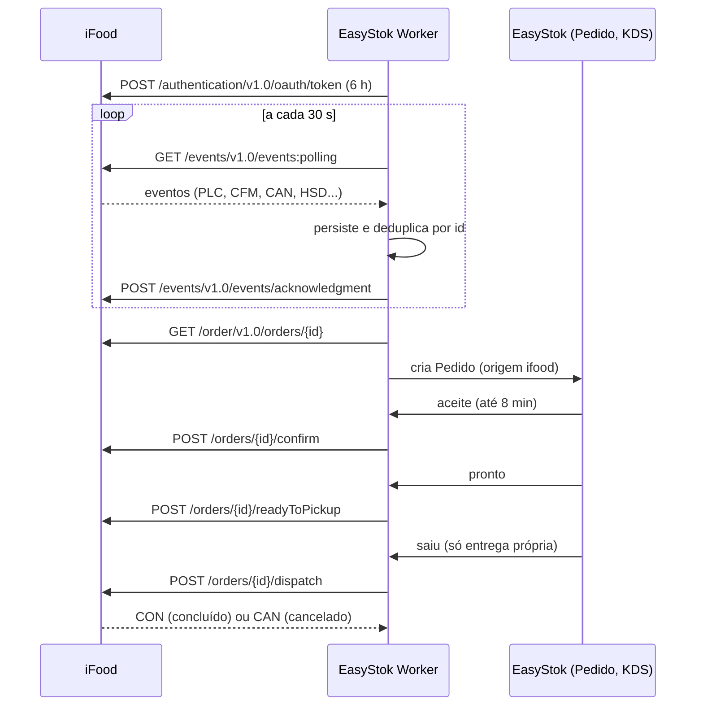

# 2. Como a API funciona nos módulos do objetivo

Síntese. A referência completa, com cada endpoint, campo e URL, está em
[fontes/api-ifood-pedidos.md](fontes/api-ifood-pedidos.md) e
[fontes/api-ifood-catalogo-merchant.md](fontes/api-ifood-catalogo-merchant.md). Siglas de URL no [README](README.md).

Base única: `https://merchant-api.ifood.com.br/<módulo>/<versão>`. Versões vigentes: Authentication v1.0, Events v1.0,
Order v1.0, Merchant v1.0, Catalog v2.0 (v1 descontinuada em 2024) (https://developer.ifood.com.br/pt-BR/docs/references; G-cat/versioning).

## 2.1 Visão de fluxo

## 2.2 Autenticação

| Tema | Regra | Fonte |
|---|---|---|
| Token | `POST /authentication/v1.0/oauth/token`, form-urlencoded | U/authentication/centralized |
| App centralizado | `grantType=client_credentials` com clientId e clientSecret. Sem refresh token: pedir outro quando expirar | U/authentication/centralized |
| App distribuído | `userCode` (expira em 600 s), a loja autoriza e devolve `authorizationCode`; depois `authorization_code` e `refresh_token` | U/authentication/distributed |
| Validade | 21600 s (6 h); tamanho máximo do token `[NÃO CONFIRMADO]` (N17) | U/authentication/distributed |
| Uso | `Authorization: Bearer <token>`; renovar só quando expirar | U/authentication/centralized; U/order/homologation |
| Escopo | Por módulo escolhido no app; escopos finos `[NÃO CONFIRMADO]` | G/first-steps/create-app |

## 2.3 Eventos

| Tema | Regra | Fonte |
|---|---|---|
| Polling | `GET /events/v1.0/events:polling` a cada 30 s. 200 com lista, 204 vazio | U/events/polling-overview |
| Presença | O polling mantém a loja online no iFood. Sem polling a loja sai do ar | U/events/polling-overview; G-mer |
| Vários merchants | Header `x-polling-merchants`, até 100 por chamada; obrigatório acima de 500 merchants no token | U/events/polling-overview |
| Ack | `POST /events/v1.0/events/acknowledgment` com `[{"id"}]`, depois de persistir, para todo evento recebido, inclusive os não usados | U/events/polling-overview |
| Entrega | Fora de ordem e com repetição (até PLACED). Ordenar por `createdAt`, deduplicar por `id` | U/events/polling-overview |
| Retenção | Até 8 h após a entrega do pedido, e só voltam eventos sem ack. Eventos fora do filtro do polling recebem ack automático | U/events/polling-overview |
| Punição | 50 entregas sem ack geram strike; 100 strikes bloqueiam o polling por 5 min e 60 min de cooldown | U/events/polling-overview |
| Webhook | Só app centralizado. 202 em até 5 s, HMAC-SHA256 do corpo bruto com o clientSecret no header `X-IFood-Signature`, retentativa por 15 min, desabilitado após 72 h de falha. Sem ack: evento que falhou pode se perder, por isso a doc indica o polling como contingência | U/events/webhook-overview; U/events/webhook-signature; U/events/webhook-request |
| Códigos | PLC, CFM, PRS, RPS, RTP, DSP, CON, CAN, CAR, CARF, OPA, DAR, HSD, HSS, ADR, GTO, AAO, CLT, AAD, DRGO, DRDO, DRCR, DGAC (SPS e SPE só grocery) | U/order/events |

## 2.4 Pedido

| Tema | Regra | Fonte |
|---|---|---|
| Detalhe | `GET /order/v1.0/orders/{id}`. 404 se ainda não disponível: retry com backoff até 10 min. Guardado 7 dias | U/order/endpoints; U/order/workflow |
| Ações | `confirm`, `startPreparation`, `readyToPickup`, `dispatch` (só entrega própria, depois do pronto), `requestCancellation`; todas 202 e assíncronas (o efeito chega como evento) | U/order/endpoints |
| Prazo de aceite | 8 min. IMMEDIATE conta de `createdAt`; SCHEDULED conta de `preparationStartDateTime`. Sem aceite: cancelamento automático e penalidade | U/order/fundamentals |
| Conclusão automática | Restaurante com entrega iFood: na entrega ou em 6 h. Entrega própria: 4 h. Em pedido agendado o prazo conta do horário agendado; mercado e farmácia: 13 h | U/order/workflow |
| Cancelamento pela loja | Motivos de `GET /cancellationReasons`, lista dinâmica por pedido (não fixar códigos; a faixa 501 a 512 não tem o 510); efetivo só com CAN | U/order/cancellation |
| Cancelamento pelo cliente | Via Plataforma de Negociação: HSD com `expiresAt`, resposta `accept`, `reject` ou `alternative`; HSS fecha | U/order/handshake-platform |
| Alteração após aceite | OPA com itens adicionados, editados ou removidos | U/order/events; U/order/cancellation |
| Excesso de cancelamento | Pode fechar a loja temporariamente | U/order/cancellation |

## 2.5 Loja (Merchant)

| Tema | Regra | Fonte |
|---|---|---|
| Status | `GET /merchants/{id}/status`: `state` OK, WARNING, CLOSED, ERROR, com `validations` (is-connected, opening-hours, unavailabilities, radius-restriction, payout-blocked, terms-service-violation) | OA; G-mer |
| Pausa | Interrupções: criar, listar, remover. 1 min a 7 dias, sem sobreposição. `reopenable=false` indica penalidade | OA; G-mer |
| Horário | `PUT /opening-hours` com `shifts` (dayOfWeek, start, duration). Dia ausente fica fechado. Só o horário padrão do Marketplace | G-mer |
| Tempo de preparo | `myPreparationTime`, 5 a 70 min, header `X-iFood-Customer-ID` | OA; G-mer |

## 2.6 Catálogo

| Tema | Regra | Fonte |
|---|---|---|
| Hierarquia | Catálogo > contexto (DEFAULT, WHITELABEL, INDOOR) > categoria > item > produto > grupo de complementos > opção | G-cat/fundamentals |
| Vínculo com o ERP | `externalCode`, único por merchant; aceito nos lotes no lugar do id; `id` do item é UUID v4 gerado pelo integrador | G-cat/introduction; OA |
| Criar ou substituir | `PUT /items` com item, produtos, grupos e opções (idempotente) | OA; G-cat/introduction |
| Ajuste pontual | `PATCH /items/{itemId}` (merge-patch): status, preço, externalCode, shifts | OA |
| Lote | `PATCH /products/price` e `/products/status` (202, `batchId`), conferir em `GET /batch/{batchId}` | OA; G-cat/errors-and-troubleshooting |
| Estoque | `POST /inventory` com `amount`; em zero, os itens ligados pausam | OA |
| Item some do app quando | item ou categoria não AVAILABLE, sem preço, grupo obrigatório sem opção disponível, fora do turno ou contexto errado | G-cat/errors-and-troubleshooting |

## 2.7 Limites e erros

| Tema | Valor | Fonte |
|---|---|---|
| Polling | 6000 req/min por token | U/events/polling-overview |
| Catalog v2 | 3000 req/min; 5000 em preço, status, estoque e batch | RL |
| Merchant | 100 a 300 req/min; status 20000 | RL |
| Uso indevido | Em 24 h: erro máximo de 1% em `/events:polling` e `/status`; 2% em `/orders/{id}`, `/confirm`, `/requestCancellation`, `/merchants`, `/merchants/{id}` e `/interruptions`; ack mínimo de 95%; polling abaixo de 30 s é infração. Bloqueio em 3 níveis | https://developer.ifood.com.br/pt-BR/docs/getting-started/documentation/improper-use |
| Erros | 400, 401, 403 (com `unauthorizedMerchants` no polling), 404, 409, 413, 422, 429, 500; corpo `code`, `message` e às vezes `details` | U/order/cancellation; OA |
| Retry | Backoff (imediato, 1 s, 2 s, 4 s); não repetir 4xx salvo 429 | G-cat/errors-and-troubleshooting |
| Boas práticas | Tolerar enums novos, isolar cada merchant, reusar token | https://developer.ifood.com.br/pt-BR/docs/getting-started/documentation/best-practices |

## 2.8 Divergências na própria documentação

A doc oficial se contradiz em pontos que mudam código. Regra adotada: seguir a referência OpenAPI e provar na loja de teste antes de codificar.

| Tema | Lado A | Lado B | Fonte |
|---|---|---|---|
| Caminho do polling e do ack | `/events/v1.0/events:polling` e `/events/acknowledgment` | `/order/v1.0/orders:polling` e `orders:acknowledgment` | U/events/polling-overview × U/order/workflow |
| Limite do ack | 2000 IDs | 10000 | U/events/polling-overview |
| Verbo de readyToPickup e dispatch | POST | PUT | U/order/endpoints × U/order/homologation |
| Timeout do webhook | 5 s | 30 s | U/events/webhook-overview × U/order/homologation |
| Preço e status em lote | `/items/price` e `/items/status` | `/products/price` e `/products/status` (os primeiros obsoletos) | G-cat/workflow × OA |
| Campo do estoque | `quantity` | `amount` | G-cat/guides/availability × OA |
| `externalCode` duplicado | 409 | reuso do registro | G-cat/introduction × G-cat/errors-and-troubleshooting |
| `status` no detalhe do pedido | ausente | presente | U/order/details × U/order/endpoints |
| `sponsorshipValues[].name` | IFOOD, EXTERNAL, MERCHANT, CHAIN (MERCHANT = desconto) | OWN, EXTERNAL, PARTNER, CHAIN (OWN = pagamento, PARTNER = desconto) | U/order/details (duas tabelas na mesma página) |
| Endpoint de preço e status na homologação do Catalog | `PATCH /items/price` e `/items/status` | marcados obsoletos no OpenAPI | HC × OA |
| Início dos 8 min em pedido agendado | `preparationStartDateTime` | outra referência na homologação | U/order/fundamentals × U/order/homologation |

Lista completa: [pedidos, divergências](fontes/api-ifood-pedidos.md) e [catálogo, §8](fontes/api-ifood-catalogo-merchant.md).
