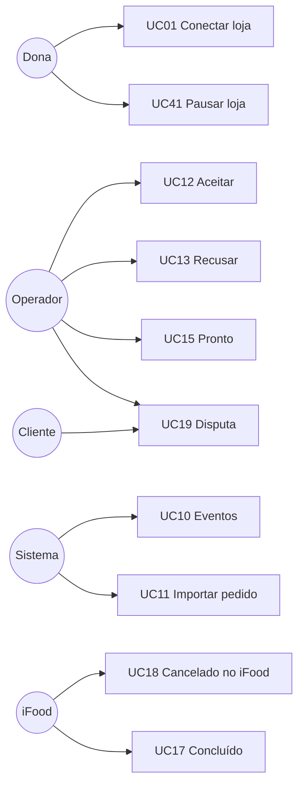

# 6. Casos de uso

Atores: **Dona** (administra a loja), **Operador** (balcão e cozinha), **Sistema** (worker do EasyStok), **iFood** (API e eventos), **Cliente** (no app iFood).
Exceções numeradas como `E.n`. Siglas de URL no [README](README.md).

## 6.1 Conexão

| UC | Ator | Fluxo principal | Exceções | RF |
|---|---|---|---|---|
| UC01 Conectar loja | Dona | 1. Informa o merchantId no EasyStok. 2. Aprova o app no Portal do Parceiro (aba Permissões). 3. Sistema gera token e lê `GET /merchants`. 4. Confirma o merchant na lista e grava o vínculo | E.1 merchant fora da lista: autorização pendente no Portal. E.2 merchantId já vinculado a outra empresa: bloquear. E.3 app ainda não homologado: o iFood não libera a autorização (G/first-steps/request-access) | RF01 |
| UC02 Desconectar | Dona | Desliga o vínculo; o polling deixa de enviar o merchant | E.1 pedidos abertos: a conexão passa a "desvinculando", continua no polling até o último pedido concluir ou cancelar e só então sai do `x-polling-merchants`. E.2 revogação feita no Portal: o polling devolve 403 com `unauthorizedMerchants`; marcar a conexão como revogada | RF01, RF19 |
| UC03 Renovar token | Sistema | Pede token novo quando o atual expira (6 h) | E.1 401 Bad credentials: alertar e parar o polling. E.2 5xx: backoff. E.3 401 no meio do ciclo (token compartilhado entre lojas): renovar e repetir a chamada uma vez | RF02 |

## 6.2 Pedidos

| UC | Ator | Fluxo principal | Exceções | RF |
|---|---|---|---|---|
| UC10 Consumir eventos | Sistema | 1. Polling a cada 30 s. 2. Grava cada evento (dedupe por `id`). 3. Ack de todos. 4. Despacha por `code` | E.1 evento repetido: só ack. E.2 fora de ordem: ordenar por `createdAt`; evento de pedido ainda não importado espera o PLC ou dispara a importação. E.3 falha ao gravar: não dar ack. E.4 429: backoff. E.5 EasyStok parado: UC52. E.6 strikes por falta de ack: alerta. E.7 evento sem uso (RPS, DRCR, DGAC) ou `code` desconhecido: UC26 | RF03, RF27, RF30 |
| UC11 Importar pedido | Sistema | 1. PLC. 2. `GET /orders/{id}`. 3. Resolve empresa e loja pelo merchantId. 4. Traduz itens e complementos. 5. Cria o pedido em `Aguardando` com os valores. 6. Notifica a operação | E.1 404 no detalhe: retry até 10 min, depois alerta. E.2 item sem `externalCode` ou não mapeado: entra sem produto e com alerta (D06). E.3 `isTest`: marcar teste. E.4 SCHEDULED: preencher `AgendadoParaEm`. E.5 `orderAmount` diferente da soma interna: alerta. E.6 PLC repetido: ignorar pelo id externo. E.7 loja fechada no EasyStok: entra mesmo assim (o iFood já vendeu). E.8 merchantId sem vínculo: gravar o evento sem empresa, dar ack e alertar. E.9 falha permanente ao processar evento já gravado: marcar com erro após N tentativas, alertar e seguir com os demais. E.10 TAKEOUT ou DINE_IN: UC27 | RF04 a RF07, RF18 |
| UC12 Aceitar | Operador ou Sistema | Operador aceita no console; Sistema chama `confirm`; CFM confirma | E.1 8 min sem aceite: o iFood cancela (CAN com `TIMEOUT_EVENT` no `metadata`); vira UC18. E.2 CARF: avisar. E.3 aceite automático ligado: Sistema confirma ao importar | RF08, RF09 |
| UC13 Recusar ou cancelar pela loja | Operador | Lista motivos de `cancellationReasons`, escolhe, Sistema chama `requestCancellation`; vira Cancelado ao receber CAN | E.1 `OrderExceededCancellationDeadline`: mostrar e manter. E.2 cancelamento já em andamento. E.3 CARF: manter o pedido e avisar. E.4 excesso de cancelamentos pode fechar a loja (U/order/cancellation). E.5 CAR (cancelamento solicitado): marcar "cancelamento em andamento" até CAN ou CARF | RF10, RF26 |
| UC14 Iniciar preparo | Operador | Mudar para `Preparando` no KDS envia `startPreparation` | E.1 falha na API: retentar pelo outbox; não bloquear a cozinha. E.2 pedido não aceito: o KDS não inicia o preparo (aceite automático conta como aceito) | RF11 |
| UC15 Marcar pronto | Operador | `Pronto` no KDS baixa estoque e envia `readyToPickup` | E.1 item sem produto: sem baixa (alerta já emitido). E.2 saldo insuficiente: baixa negativa e `estoque.desacerto` (regra atual). E.3 falha na API: retentar | RF11, RF17 |
| UC16 Despachar | Operador | `SaiuParaEntrega` envia `dispatch` | E.1 `deliveredBy=IFOOD`: não chamar dispatch; o estado vem de CLT. E.2 pedido ainda não `Pronto`: a máquina bloqueia; o KDS exige `Pronto` antes (que baixa o estoque). E.3 TAKEOUT ou DINE_IN: sem despacho (UC27) | RF11 |
| UC17 Concluir | iFood | CON muda para `Entregue` | E.1 conclusão automática por tempo (4 h ou 6 h): mesma ação. E.2 pedido antes de `Pronto` no EasyStok: registrar e alertar, sem forçar (como UC23); o operador marca `Pronto` (baixa estoque) e o Sistema aplica a conclusão em seguida | RF12, RF17 |
| UC18 Cancelado no iFood | iFood | CAN cancela no EasyStok por sistema, devolve estoque e registra motivo | E.1 já entregue no EasyStok: cancelar e registrar (o reembolso é do iFood). E.2 CAN de pedido não importado: registrar só o evento | RF12, RF13 |
| UC19 Disputa | Cliente, Operador | HSD abre pendência com prazo; operador aceita (motivo), rejeita ou propõe alternativa (reembolso, benefício ou tempo extra); HSS fecha | E.1 prazo vence: o iFood executa `timeoutAction`; HSS EXPIRED. E.2 422 já respondida. E.3 400 motivo ou valor inválido. E.4 aceite de cancelamento total vira UC18 pelo CAN. E.5 aceite parcial (item retirado, reembolso parcial): itens, valores e estoque ajustados como UC20; a forma como chega é `[NÃO CONFIRMADO]` (N25) | RF14 |
| UC20 Itens alterados | iFood | OPA atualiza itens e totais; reimprime comanda | E.1 estoque já baixado (depois de `Pronto` ou despachado): baixar ou estornar a diferença e alertar a operação. E.2 item novo não mapeado: E.2 de UC11. E.3 conferir `orderAmount` com a soma, como UC11 E.5 | RF15 |
| UC21 Entregador iFood | iFood | ADR, GTO, AAO, CLT, AAD atualizam a linha do pedido; `tracking` opcional a cada 30 s | E.1 devolução (DRGO, DRDO): alerta à operação | RF12 |
| UC22 Validar código de coleta | Operador | Digita o código do entregador; Sistema chama `validatePickupCode` | E.1 código inválido: não entregar | RF29 |
| UC23 Mudança feita fora | iFood | Evento de outro sistema (Gestor de Pedidos) aplica o estado no EasyStok | E.1 transição não permitida pela máquina de estados: registrar e alertar, sem forçar | RF12 |
| UC24 Imprimir comanda | Sistema | Canhoto com dados do iFood | E.1 documento do entregador: sem CPF e endereço | RF06, RF07, RF16 |
| UC25 Cliente mudou o endereço | iFood | DAR atualiza o endereço do pedido, reimprime a comanda e avisa a operação | E.1 entrega própria já despachada: alerta ao entregador. E.2 se o iFood exige resposta da loja: `[NÃO CONFIRMADO]` (N24) | RF26 |
| UC26 Evento sem uso | Sistema | RPS, DRCR, DGAC e `code` desconhecido: gravar, dar ack e registrar; RPS pode virar dica no KDS | E.1 code novo frequente: alerta para avaliar suporte | RF27 |
| UC27 Retirada e consumo no local | Operador | TAKEOUT ou DINE_IN: aceitar, preparar, `Pronto`; o cliente retira, sem despacho | E.1 regras próprias da retirada: `[NÃO CONFIRMADO]` (N07) | RF28 |

## 6.3 Cardápio e loja

| UC | Ator | Fluxo principal | Exceções | RF |
|---|---|---|---|---|
| UC30 Mapear cardápio | Dona | Lista itens do iFood (`GET /catalogs`, itens por categoria) e associa cada um a item ou porção do EasyStok, gravando o `externalCode` nos dois lados | E.1 item sem correspondência: fica sem baixa. E.2 `externalCode` duplicado: comportamento `[NÃO CONFIRMADO]` (409 ou reuso) | RF05 |
| UC31 Publicar item | Sistema | `PUT /items` com produto, grupos e opções | E.1 422 (sem preço, min > max). E.2 413 imagem. E.3 `id` fora de UUID v4: 404 | RF24 |
| UC32 Atualizar preço | Dona | Preço muda no EasyStok, Sistema envia lote e confere `GET /batch` | E.1 `result=FAILURE` em parte: reportar por item. E.2 lote em PROCESSING: consultar a cada 5 a 10 s | RF23 |
| UC33 Pausar e reativar item | Operador | Mudança de disponibilidade envia status | E.1 item não mapeado: nada a enviar. E.2 grupo obrigatório sem opção disponível some o item (G-cat/errors-and-troubleshooting) | RF20 |
| UC34 Enviar saldo | Sistema | `POST /inventory` com saldo | E.1 saldo zero pausa o item no iFood | RF25 |
| UC40 Ver status da loja | Dona | Console mostra `state` e `validations` | E.1 `payout-blocked` ou `terms-service-violation`: só resolve no Portal | RF19 |
| UC41 Pausar e reabrir loja | Dona | `ForcarFechada` cria interrupção; voltar remove (fase 2; na fase 1 a pausa é feita no Portal do Parceiro ou no Gestor de Pedidos) | E.1 sobreposição. E.2 `reopenable=false`: penalidade, não reabre pela API. E.3 409 ao remover recém-criada | RF21 |
| UC42 Enviar horário | Dona | Expediente vira `shifts` | E.1 dia sem turno fecha o dia no iFood | RF22 |

## 6.4 Transversal

| UC | Ator | Fluxo principal | Exceções | RF |
|---|---|---|---|---|
| UC50 Vigiar a integração | Sistema | A cada ciclo mede token, último polling, taxa de erro, taxa de ack e 429; alerta no vigia | E.1 polling parado: alerta crítico (loja sai do ar no iFood) e UC52 | RF19 |
| UC51 Homologar | Dev e Felipe | Roteiro das 5 etapas de Order e Events no Portal; vídeos do Catalog por chamado | E.1 reprovação: corrigir e tentar após 4 h | RF32; 01 §1.2 |
| UC52 Contingência e retomada | Dona, Sistema | EasyStok fora: a casa opera no Gestor de Pedidos do iFood. Ao voltar: o polling traz os eventos sem ack (até 8 h após a entrega); para cada pedido aberto, `GET /orders/{id}`; aplica o que mudou como UC23 | E.1 parada maior que a retenção: importar os abertos pelo detalhe e marcar a lacuna. E.2 pedido aceito fora: registrar o aceite sem chamar `confirm` | RF30 |
| UC53 Alerta de fila | Sistema | Pedidos abertos do iFood acima do limite da loja geram alerta para a dona pausar | E.1 limite não configurado: sem alerta | RF31 |
