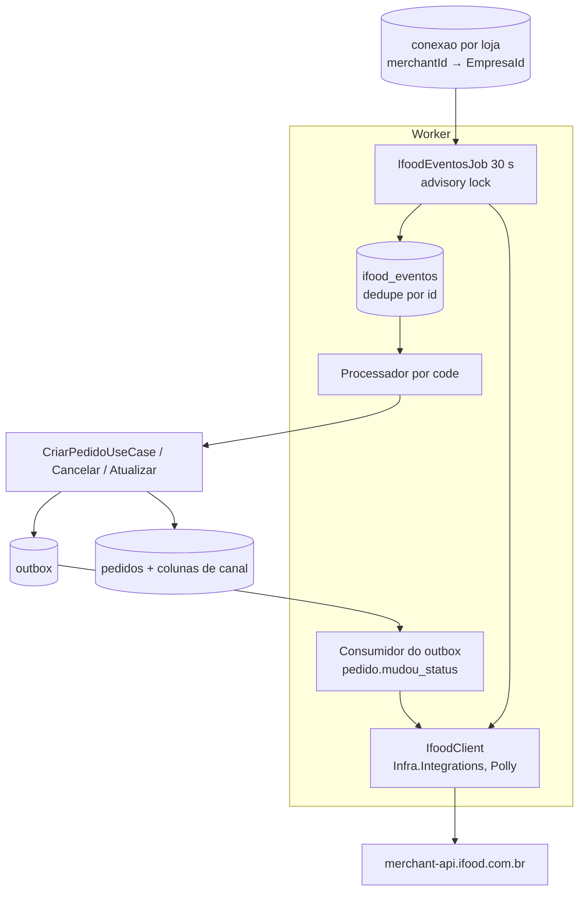

# 7. Análise: dois olhares

Fatos com fonte nos arquivos anteriores; aqui só o juízo. **Inferência** e **Recomendação** marcadas.

## 7.1 Analista de sistemas sênior

| Tema | Leitura |
|---|---|
| Valor | O iFood vende sozinho; o ganho do EasyStok é tirar a digitação dupla, pôr o pedido no KDS e no estoque e manter cardápio e loja coerentes. Sem volume no iFood o ganho é zero; por isso a D3-02 segue como portão (D01) |
| Processo que muda | Hoje a casa aprova cada pedido (`AguardandoAprovacaoBaba`) e cobra sinal em encomenda. No iFood o pedido chega pago e com 8 min para aceitar. A cozinha passa a ter um relógio externo |
| Capacidade | O site limita produção por janela e vaga (`CheckoutCoreService.cs:150-262`). O iFood não conhece essas vagas: pode vender além do que a cozinha faz (L23). Mitigação: pausar a loja ou itens quando a capacidade esgotar (D15) |
| Duas telas | Se a casa mantiver o Gestor de Pedidos do iFood aberto, há duas fontes de aceite. A API manda os eventos dos dois (UC23); é preciso escolher onde se trabalha (D05) |
| Dinheiro | O total do iFood tem quatro naturezas (desconto da loja, subsídio do iFood, taxa do iFood, frete). Sem separar, o Extrato e o relatório por canal mentem (L03, L17, L18) |
| Cliente | O telefone vem mascarado com localizador e expira; o documento é só para NF. Criar `Cliente` a partir do iFood traria cadastro pobre e risco LGPD (D10) |
| Cardápio | O iFood tem complementos; o EasyStok não. Se o cardápio do iFood usar complementos, o pedido chega com informação que o EasyStok não estrutura (L05) |
| Penalidades | Aceite atrasado, cancelamento demais e EasyStok fora do ar (sem polling) tiram a loja do ar ou penalizam. O risco operacional é maior que o técnico |
| Escopo recomendado | **Recomendação:** fase 1 só pedidos (Order e Events), porque é o que a homologação automática cobre e o que tira trabalho da casa. Fase 2 disponibilidade e loja. Fase 3 catálogo completo, só se a casa quiser gerir o cardápio do iFood pelo EasyStok |

Riscos do negócio:

| Risco | Prob. | Impacto | Mitigação |
|---|---|---|---|
| Worker parado tira a loja do ar no iFood | Média | Alto | RNF01, alerta UC50, plano de contingência (Gestor de Pedidos do iFood) |
| Venda acima da capacidade | Média | Alto | D15 |
| Aceite fora do prazo | Baixa com alerta | Alto | RF08, aceite automático opcional |
| Item não mapeado sem baixa | Alta no início | Médio | UC30 antes de ligar; alerta por pedido |
| Custo da API desconhecido | — | ? | P12 |

## 7.2 Desenvolvedor sênior

Arquitetura proposta (**Recomendação**, reaproveita o que existe em [base §9](fontes/easystok-base.md)):

| Tema | Leitura |
|---|---|
| Porta | `ICanalPedidoExterno` (já prevista em `04-m3-atendimento.md:297`) com adaptador iFood em `Infra.Integrations`. Mantém o domínio sem iFood |
| Credencial | No app centralizado o clientId e o clientSecret são do EasyStok, não da loja. O cofre por empresa (`credencial_integracao`) não é o lugar; vai em segredo do servidor, como os segredos do app Mercado Pago (credencial de plataforma aceita na ADR-0061; registrar emenda). A conexão por loja segue a ADR-0061 D2: loja desconectada sai do `x-polling-merchants`. Por loja só se guarda o merchantId e o estado da conexão (L14, spec I5.1). **Inferência** a partir de U/authentication/centralized |
| Token | Um token para todas as lojas, cache em memória com expiração; sem refresh token |
| Host do job | **Recomendação:** no Worker, como os vigias (ADR-0057, I11.2), para não cair com o deploy da API. O `CorridasLalamoveJob` roda no host da API (`BackgroundJobServiceCollectionExtensions.cs:63`); dele só se copia o padrão de advisory lock e tenant |
| Eventos | Job com advisory lock a cada 30 s, com `x-polling-merchants` em blocos de 100. Tabela própria de eventos com `EmpresaId`, porque `webhook_recebidos` não tem tenant (L15) |
| Tenant | Job cross-tenant com `UseRowLevelSecurityBypass` só para ler a conexão; o processamento de cada evento roda com `SetCurrentTenant(empresa)` |
| Saída de status | Consumir `pedido.mudou_status` do outbox e chamar a ação do iFood. Dá retry e não trava o KDS. Anti-eco: ignorar o que veio do próprio iFood pela `Origem` do evento (RNF19) |
| Modelo de dados | Migração (tier alto): no `pedidos`, canal, id externo (único por empresa e canal), `displayId`, tipo de pedido, quem entrega, valores (desconto, subsídio, taxas, pago online, troco) e o JSON bruto. Complementos em tabela filha do item ou JSON por item (D07). Mapeamento de `externalCode` por item e porção do cardápio |
| `MobileOrderId` | Não reutilizar: o cancelamento devolve estoque por esse campo (`CancelarPedidoUseCase.cs:70`) (D16) |
| Cancelamento por sistema | Comando novo que pula três efeitos do cancelamento atual quando há pagamento: nível Gerente (`EfeitosCancelamentoPedido.cs:25-29`), `devolucao_a_fazer` e saldo a devolver (o iFood reembolsa) (L19) |
| Máquina de estados | Entrar em `Aguardando`; o aceite é registro, não estado, para não mexer no `PedidoStateMachine` agora. Transições vindas do iFood que a máquina não permite são registradas e alertadas, nunca forçadas |
| Divergências da doc | Onze pontos em que a doc oficial se contradiz ([02 §2.8](02-api.md#28-divergências-na-própria-documentação)). Primeiro passo técnico: spike na loja de teste gravando as respostas reais, que viram fixtures dos testes |
| Regras do projeto | ADR-0010: bypass de RLS só em job, em escopo `using`, para listar ids; cada loja em escopo próprio com tenant fixado (I11.2). ADR-0061 D1: adaptador HTTP em `Infra.Integrations/<família>` |
| Fila de migração | As colunas do canal em `pedidos` disputam a fila única de migração com I6.2 (`LojaResolvidaId` no dedupe de webhook). Se D04 for webhook, I6.2 vem antes. Ordem a decidir com o Felipe |
| Testes | Red-Green com fixtures reais: tradução do pedido (puro, unitário), deduplicação e ordem (integração com Postgres), cliente HTTP contra servidor falso, e roteiro da homologação como teste de aceite |
| Tamanho | **Inferência:** fase 1 é maior que a integração do Lalamove (pedido com valores e complementos, disputa, OPA). Sem número de horas, que não medi |

Riscos técnicos:

| Risco | Mitigação |
|---|---|
| Doc oficial contraditória | Spike na loja de teste antes do código (RNF18) |
| Ack antes de gravar perde pedido | Gravar e só então ack (RNF04) |
| Duas instâncias consumindo | Advisory lock (RNF11) |
| Migração em `pedidos`, tabela quente | Colunas nulas e aditivas; sem reescrita |
| CDN do iFood bloquear o VPS | Testar no primeiro dia (P09) |
