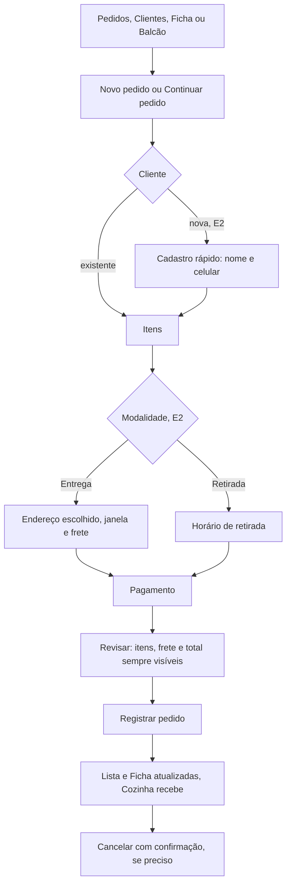

# Plano da jornada do pedido (#2944)

- Data: 2026-11-20
- Base medida: `master` `6c93bfe0a`
- Specs: [E1](e1-console-ux-copy-visual.md) (tier baixo) e [E2](e2-retirada-endereco-cliente-nova.md) (tier alto) e [E3](e3-cobranca-pdf.md) (tier baixo)
- Regra do plano: nada de micro PR. Cada entrega é UMA PR completa, testada (Red, Green), validada no navegador real (390 px e desktop, prints antes e depois), mergeada e deployada.

## 1. Problema

A janela Novo pedido (#2940) entrou no ar, mas a jornada ainda falha em três pontos que a Tatiana sente: botão parado sem dizer por quê, texto que fala a língua do sistema e não a da loja, e venda que sai do fluxo (cliente nova, retirada, segundo endereço). A auditoria de 2026-11-19 mediu 18 achados visuais (3 P1), 16 lacunas de jornada e cerca de 194 textos a trocar. Taxa de entrega provada: 13 de 21 itens.

## 2. Três padrões por trás dos achados

| Padrão | Sintoma típico | Regra que falta |
|---|---|---|
| Sintoma em vez de regra | Clique morto corrigido (#2932), mas Continuar, Registrar e "+" seguem mudos | Toda ação desabilitada ou sem efeito mostra o motivo ao lado |
| Jargão na tela | "Janela fechada", "modelo aprovado", "Comanda 21", "Cliente WhatsApp", "Assistente respondendo" com IA desligada | Um glossário só (`rotulos.js`) e guarda de vocabulário com teto que só desce |
| Merge visto como pronto | Janela nunca vista em produção, prova só por regex, deploy sem evidência | Gate por entrega: só diz "pronto" com prova no navegador real e em produção |

## 3. Mapa das 16 lacunas

| Lacuna | Onde | Entrega |
|---|---|---|
| G1 Cancelar pedido não existe em Pedidos | `PainelPedidos.jsx:118` | E1 |
| G2 Editar pedido registrado | `comanda.js:91-95`, API | Fora (Console + API, G) |
| G3 Retirada no balcão | `NovoPedidoJanela.jsx:55`, `Pedido.cs:45` | E2 |
| G4 Escolher endereço | Console nunca envia `enderecoId` | E2 |
| G5 Cadastro rápido de cliente nova | `cliente.js:74`, `POST /api/clientes` | E2 |
| G6 Cliente sem celular, aviso de que não será avisada | #2919 | E1 |
| G7 Voltar do navegador fecha a tela | `Modal.jsx` | E1 |
| G8 Registrar não prova atualização da lista e da Ficha | `comanda.js:200` | E1 |
| G9 Status Em preparo a Entregue na lista Pedidos | `PainelPedidos.jsx:118` | Fora (M) |
| G10 Entregue com saldo (409) vira rotina | `pagamento.js:105` | E1 só o texto; atalho fora |
| G11 Aviso a cliente de outro canal | #2919, API de canal | Fora |
| G12 Contagem de pedidos e pontos diverge | #2777 | Fora |
| G13 Telefone principal sem invariante | #2778 | Fora |
| G14 Alterações do Atendimento sem histórico | #2779 | Fora |
| G15 IA não coleta endereço | #2835 | Fora |
| G16 Sem prova de chegada à Cozinha | `kdsApi.js:10` | E1 (prova) |

Resumo: E1 cobre 6 (G1, G6, G7, G8, G10 em texto, G16), E2 cobre 3 (G3, G4, G5), 7 ficam fora.

## 4. Sequência

E1 primeiro: tier baixo, só Console, merge no verde, e entrega a regra do motivo e o glossário que a E2 reaproveita. E2 depois: tier alto (migração), PR aberta até a label `aprovado`. A E2 só começa o código com a decisão do Felipe (secção 7).

## 5. Jornada alvo

Em todo nó, ação bloqueada mostra o motivo.

## 6. Gates por entrega

| Gate | E1 | E2 |
|---|---|---|
| Planejado | Esta spec | Esta spec, após decisão da secção 7 |
| Executado | Código na branch própria | Idem, com migração |
| Testado | Red visto falhando, Green; provas `prova-2944-*.mjs`; build-check | Idem, mais testes de domínio e integração com Postgres |
| Revisado | `/code-review` sem Critical | Idem |
| PR aberta | Com `closes #N` e changelog | Aberta e parada até `aprovado` |
| Mergeado | Squash no verde (tier baixo) | Só depois do `aprovado` |
| Deployado | `vps-deploy.sh` e `console-deploy.sh` | Idem, com dump antes da migração |
| Validado | Chrome real 390 px e desktop, prints antes e depois, uso em produção | Idem, mais pedido de retirada e de segundo endereço em produção |
| Limpo | Branch, worktree, working tree | Idem |

Gate não executado é `Pendente`, nunca "verde" por inferência.

## 7. Decisão pendente do Felipe (E2)
**Decidido pelo Felipe em 2026-11-20:** opção A (coluna `Modalidade` no Pedido, com migração). O horário da retirada fica na janela: a retirada também escolhe `JanelaId` e `DataEntrega`, que continuam obrigatórios no input. Não há janela especial nem campo novo de horário.

Como saber se um pedido é retirada:

| Opção | Efeito | Custo |
|---|---|---|
| A. Coluna `Modalidade` no Pedido, via migração (RECOMENDADA) | Estado explícito; relatório, KDS e resumo leem direto. Pedido de balcão legado NÃO vira retirada: fica como Entrega (default) | 1 migração reversível, tier alto |
| B. Derivar retirada da ausência de endereço | Sem migração | Frágil: pedido de balcão antigo sem endereço viraria retirada por engano; cliente sem endereço cadastrado também |

Recomendação: A. Sem resposta, a E2 não abre código.

Junto: na retirada, o horário é guardado em `DataEntrega` com `JanelaId` nulo, ou numa janela de retirada própria? Hoje os dois são obrigatórios no input (`GerarPedidoConversaUseCase.cs:25-26`).

## 8. Fora e por quê

| Item | Por quê |
|---|---|
| Texto das mensagens da API (ex.: `ComandaClienteUseCase.cs:713`) | O Console casa regex contra elas; trocar só depois de migrar a lógica para códigos (E1). PR de API própria, depois |
| Valor `Cliente WhatsApp` no banco | 6 comparações no backend e `nomeDoContato.js:19`; a E1 trata só a exibição |
| Impressão (comanda em papel) | Decisão de produto à parte |
| G2, G9, G11 a G15 | Outro escopo, outra camada ou issue própria já aberta |
| Varredura de px soltos (P3 de tokens) | Diff largo e ortogonal; PR própria |
| "Gerar cobrança" em um clique com desfazer | Decisão de desenho, sem dado novo |

## 9. Não confirmado

Linhas do pacote Impeccable fora da janela (ex.: `caixa.module.css:19`, `cadastros.module.css:33`) vêm da auditoria e não foram reconferidas. Três itens "a medir" pedem captura em 390 px antes de fechar. O Console pode não ter runner vitest; ver seção de testes da E1.
